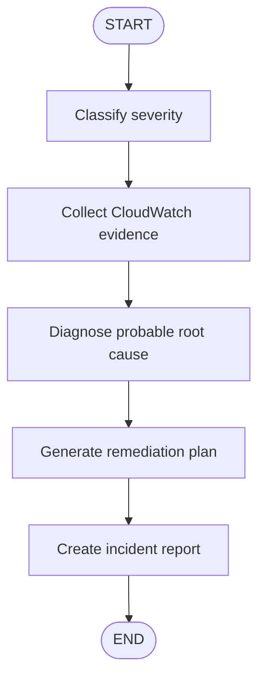

# Architecture and LangGraph workflow

## Runtime components

- **AgentCore Runtime:** managed execution boundary for the agent. The application uses `BedrockAgentCoreApp` and `@app.entrypoint`.
- **LangGraph:** deterministic workflow orchestration. Each stage is a node and edges define execution order.
- **Bedrock Converse:** model inference through `ChatBedrockConverse`.
- **CloudWatch:** read-only evidence collection for alarms, metrics, and Logs Insights.
- **Terraform foundation:** ECR, runtime IAM role, CloudWatch log group, encrypted S3 evidence bucket, and DynamoDB incident table.

## Graph

The graph intentionally separates evidence collection from LLM reasoning. The model cannot directly execute arbitrary AWS APIs. Tools are implemented in Python and use explicit AWS SDK operations.

## State

`SREState` carries the prompt, session ID, scoped context, evidence, severity, diagnosis, remediation plan, action result, final response, and errors. Avoid storing secrets or unrestricted raw logs in graph state.

## Extending the graph

Suggested production nodes:
1. `validate_scope`: verify tenant/account/region/resource allow-list.
2. `correlate_deployments`: inspect CodeDeploy/CloudTrail/EKS rollout events.
3. `query_traces`: query X-Ray or OpenTelemetry backend.
4. `check_dependencies`: inspect RDS, ElastiCache, SQS, and downstream health.
5. `approval`: wait for authenticated approval in an external workflow.
6. `execute`: call a dedicated remediation executor.
7. `verify`: compare metrics and alarms before/after action.
8. `postmortem`: generate timeline and corrective/preventive actions.

## AgentCore capabilities to consider

- Runtime for managed agent execution.
- Memory for managed short/long-term context where suitable.
- Gateway for exposing APIs and Lambda functions as governed MCP tools.
- Identity for delegated identity and credential handling.
- Policy for tool/action guardrails where available in the selected Region.
- Observability and Evaluations for traces and continuous quality checks.

Do not assume enabling one capability automatically configures the others. Provision and test each capability independently.
